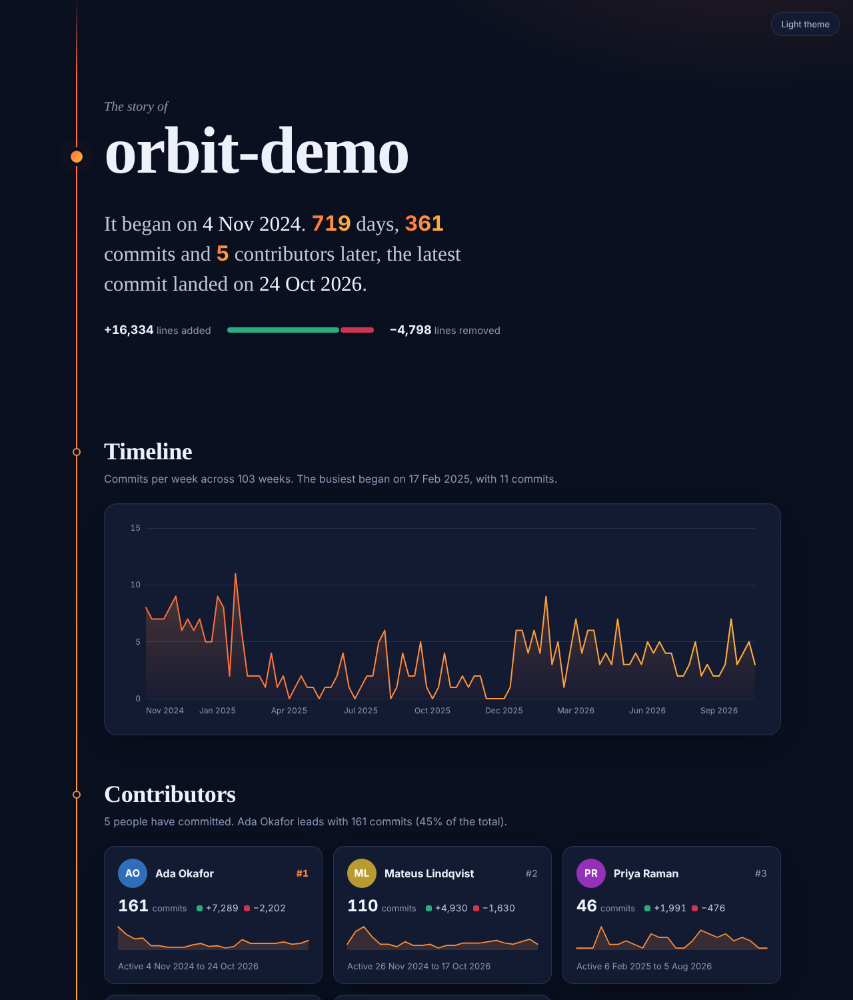
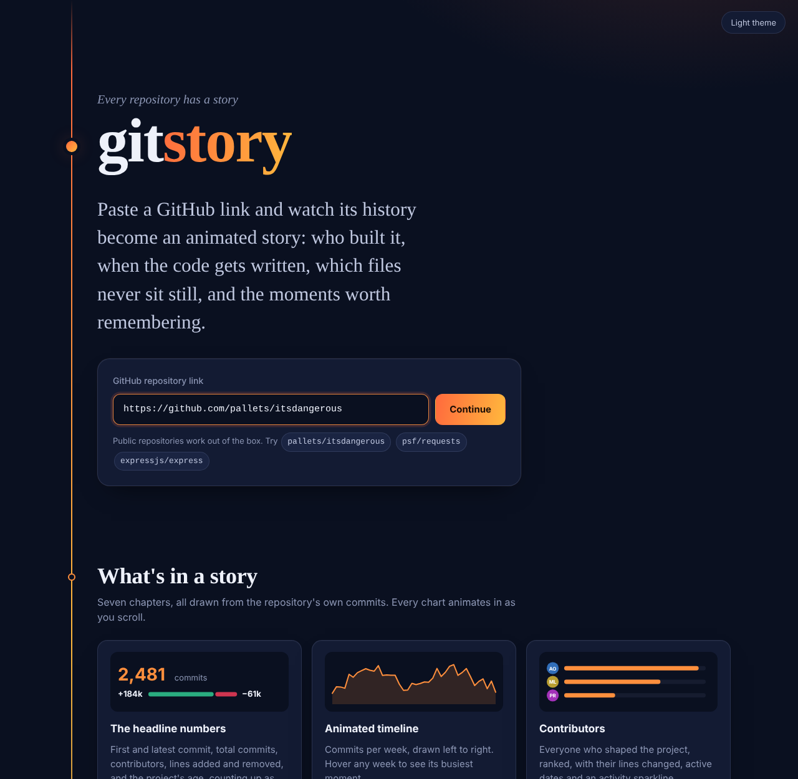

# gitstory

**Every repository has a story. gitstory turns yours into one beautiful, animated HTML page.**

Point it at a local git repository, or paste a GitHub link, and get a single self-contained report: who built it, when the code gets written, which files never sit still, and a handful of fun facts. No account, no dependencies, and the report works offline.



> The screenshot shows the report for the fictional demo repository built by [`examples/make_demo_repo.py`](examples/make_demo_repo.py). Replace `docs/screenshot.png` with a capture of your own report whenever you like.

## Features

- **Web mode**: run `gitstory --serve`, paste a GitHub link into the page, confirm, and watch the story build with live progress. Save the result from the **Download story** menu.
- **GitHub links on the command line**: `gitstory https://github.com/owner/repo` clones and reports in one step.
- **Hero summary**: repository name, first and latest commit, total commits, contributors, lines added and removed, and project age, with numbers that count up on load.
- **Animated timeline**: commits per week, drawn left to right. Hover (or use the arrow keys) to see the week, its commit count and its top commit message.
- **Contributors**: ranked cards with coloured avatar initials, commit and line counts, first and last active dates, and an activity sparkline.
- **When the code gets written**: a 7×24 heatmap of commit times plus a label derived from the data, such as "Night owl 🦉" or "9-to-5er ☀️".
- **File churn**: the 15 most-changed files and the top languages by lines changed. Renamed files keep their history.
- **Commit history**: press the button to load the latest 10 commits, then 10 more at a time. Open a commit to see its full message and every file it changed (new, deleted, renamed or edited, with lines added and removed), plus each file's history: "change 9 of 14". Click that to list every commit that ever touched the file, even across renames. Search by message, author, hash or file name, filter by commit type, copy a hash, or open the commit on GitHub.
- **Commit message insights**: average length, most common words, share of conventional-commit prefixes, and the longest and shortest messages.
- **Fun facts**: biggest single commit, longest streak, longest gap and busiest day ever. Click a commit hash to jump to it in the commit history.
- **Download story**: one button, three formats. A **long image** (one tall PNG of the whole story), a **PDF** (numbered A4 pages, split between sections rather than through them), or an **HTML** file that works offline from any folder, with every chart, the search and the clickable commit history. The image and PDF are made for reading, not clicking: they leave out the commit history and the buttons, show every listed contributor, and turn commit hashes into plain text.
- **One file, zero requests**: all CSS, JavaScript and data are inlined. Charts are hand-drawn SVG, with no chart library and no CDN.
- **Dark and light themes**, a responsive layout down to phone width, scroll-in animations, and full support for `prefers-reduced-motion`.
- **Standard library only**: Python 3.9+ and `git`. Nothing else to install.
- **Private by default**: email addresses are used to group commits and pick avatar colours, but are never written into the report.

## Install

You need Python 3.9 or newer and `git` on your `PATH`.

```bash
# from a clone of this repository
pip install .

# or straight from GitHub, isolated with pipx
pipx install git+https://github.com/<user>/gitstory
```

Replace `<user>` with the GitHub account that hosts the repository.

### Development setup (virtual environment)

```bash
git clone https://github.com/<user>/gitstory
cd gitstory

python -m venv .venv
source .venv/bin/activate        # Windows: .venv\Scripts\activate

pip install -e ".[dev]"          # gitstory itself (editable) plus pytest
pytest
```

gitstory has no runtime dependencies; `pytest` is the only thing the `dev` extra adds.

## Usage

### In the browser (web mode)

```bash
gitstory --serve --open
```

This starts a small website on your own computer (http://localhost:8765) and opens it:

1. The home page explains what gitstory does and asks for a GitHub repository link.
2. Paste a link and press **Continue**. gitstory shows which repository it found so you can check it.
3. Press **Confirm and build the story**. The page shows each step as it happens: downloading, reading every commit, drawing the story.
4. The story opens in the same tab, with buttons to start a **New story** or **Download story** (long image, PDF or offline HTML).



Links can be pasted the way you copy them: `https://github.com/owner/repo`, with `.git`, with a trailing slash, as a link to a file or branch (`/tree/main/src`), as an SSH remote (`git@github.com:owner/repo.git`), or as `owner/repo`.

Press `Ctrl+C` in the terminal to stop the server.

### As a public website (free hosting)

The web mode can run as a website anyone can use. The repository includes a `Dockerfile` and a Render Blueprint (`render.yaml`) for [Render](https://render.com)'s free plan:

1. Push this repository to your GitHub account.
2. Sign in to Render with GitHub, choose **New → Blueprint**, and pick the repository.
3. Press **Deploy**. A few minutes later the site is live at `https://<name>.onrender.com`, and every push to `main` redeploys it.

On a host, gitstory runs as `gitstory --serve --public`: it listens on `0.0.0.0:$PORT`, accepts the site's own address, logs each story, and applies limits that suit a small free server. Each one can be changed with an environment variable:

| Variable | Default | Meaning |
| --- | --- | --- |
| `GITSTORY_MAX_REPO_MB` | 150 | Stop clones that download more than this |
| `GITSTORY_CLONE_TIMEOUT` | 300 | Seconds before a clone is stopped |
| `GITSTORY_MAX_STORIES` | 10 | Finished stories kept in memory (oldest go first) |
| `GITSTORY_WORKERS` | 1 | Stories built at the same time |
| `GITSTORY_MAX_WAITING` | 6 | Stories waiting or being built before new ones are refused |
| `GITSTORY_PER_VISITOR` | 6 | New stories one visitor may start every 10 minutes |

`GET /healthz` answers `ok` for the host's health checks. Render's free plan sleeps after 15 minutes without visitors; the next visit wakes it in under a minute, and stories built before the nap are gone (their links send people to the home page with the repository filled in, one click from rebuilding it). Only public repositories work on a hosted server.

### On the command line

```bash
gitstory /path/to/repo -o report.html
gitstory https://github.com/owner/repo -o report.html
```

Every flag:

```bash
# Report on the current directory, written to ./gitstory.html
gitstory

# Report on a GitHub repository (cloned to a temporary folder, then deleted)
gitstory https://github.com/psf/requests -o requests.html

# Choose the repository and the output file
gitstory ~/code/my-project -o story.html

# Only part of the history (anything `git log` understands)
gitstory --since "2024-01-01" --until "2024-12-31"
gitstory --since "6 months ago"

# Only one person's commits (matches the author name or email)
gitstory --author "Ada"

# Open in the light theme (the page also has a toggle)
gitstory --theme light

# Open the report in your default browser when it is ready
gitstory ~/code/my-project -o story.html --open

# Web mode: a local website where you paste a GitHub link
gitstory --serve
gitstory --serve --open              # also open it in your browser
gitstory --serve --port 9000         # another port (0 picks any free one)

# Also available as a module (use this if Windows security policy blocks gitstory.exe)
python -m gitstory . -o report.html
python -m gitstory --serve --open

gitstory --version
gitstory --help
```

| Option | Default | What it does |
| --- | --- | --- |
| `repo` | `.` | Path to a local git repository (any folder inside it works), or a `https://github.com/owner/repo` link. |
| `-o`, `--output` | `gitstory.html` | Where to write the report. Missing folders are created. |
| `--since DATE` | none | Only commits after this date. Passed through to `git log`. |
| `--until DATE` | none | Only commits before this date. Passed through to `git log`. |
| `--author PATTERN` | none | Only commits whose author matches. Passed through to `git log`. |
| `--theme dark\|light` | `dark` | Theme the report opens in. |
| `--open` | off | Open the report in the default browser afterwards. With `--serve`, open the website. |
| `--serve` | off | Start the web mode instead of writing a file. |
| `--host` | `127.0.0.1` | Address the web mode listens on. |
| `--port` | `8765` | Port the web mode listens on. `0` picks a free one. |
| `--version` | | Print the version and exit. |

Errors are short and specific, and the exit code is `1`:

```text
gitstory: error: not a git repository: /tmp/somewhere
gitstory: error: this repository has no commits yet: /tmp/empty
gitstory: error: no commits match the given --since/--until/--author filters
gitstory: error: octocat/nope was not found on GitHub. Check the link; private repositories only work if your git credentials can access them.
gitstory: error: git was not found. Install it from https://git-scm.com/downloads and make sure it is on your PATH.
```

## Examples

- [`examples/sample-report.html`](examples/sample-report.html): gitstory run on its own repository.
- [`examples/demo-report.html`](examples/demo-report.html): a two-year, five-person fictional project, which shows the charts with more data.
- [`examples/make_demo_repo.py`](examples/make_demo_repo.py): builds that fictional repository so you can reproduce the demo:

  ```bash
  python examples/make_demo_repo.py orbit-demo
  gitstory orbit-demo -o examples/demo-report.html
  ```

Download a report and open it in a browser; GitHub shows HTML files as source.

## How it works

```text
git log ──► parser.py ──► stats.py ──► render.py ──► report.html
 (subprocess)  (dataclasses)  (pure functions)  (JSON + inline CSS/JS)
```

1. **`parser.py`** runs one `git log --numstat` through `subprocess`, with a `--pretty=format:` string that separates commits and fields with the ASCII record and unit separator characters (`0x1e`, `0x1f`), which do not occur in normal commit text. The output is decoded with `errors="replace"` and parsed into `Commit` and `FileChange` dataclasses.
2. **`stats.py`** is a set of pure functions over those commits: no subprocess calls, no file access, no clock. That is what the test-suite exercises with synthetic histories.
3. **`render.py`** serialises the results to one JSON blob, escapes it so that text such as `</script>` in a commit message cannot break out of the page, and inlines it together with the stylesheet and script from `gitstory/assets/` into a single HTML document.
4. **In the browser**, a small vanilla-JS renderer reads the JSON and draws everything with DOM and SVG. Repository text is always inserted as text, never as HTML.

For a GitHub link, **`github.py`** first checks the link and runs `git clone --bare --single-branch --no-tags` into a temporary folder, reading git's progress output as it goes. Steps 1 to 3 then run on that clone, and the clone is deleted.

**Web mode** (`server.py`) is built on the standard library's `http.server`. The page sends the link to a small JSON API; the server checks it, starts a background job, and the page polls the job for progress until the story is ready. Finished stories are kept in memory until the server stops, so opening one again is instant.

```text
browser                          gitstory --serve
  │  POST /api/resolve {url}  ──►  check the link   ──►  {owner, name}
  │  POST /api/stories {url}  ──►  start a job      ──►  {id, state}
  │  GET  /api/stories/<id>   ──►  cloning 45% … analysing … done
  └► GET  /story/<owner>/<repo>    the report, with "New story" and "Download story"
```

### Project layout

```text
gitstory/
├── gitstory/
│   ├── __init__.py
│   ├── __main__.py        # python -m gitstory
│   ├── cli.py             # argparse + entry point
│   ├── parser.py          # runs git log, parses it into dataclasses
│   ├── stats.py           # all the analysis, pure functions
│   ├── render.py          # builds the HTML
│   ├── github.py          # reads GitHub links, clones with progress
│   ├── server.py          # web mode: home page, JSON API, background jobs
│   └── assets/            # report and home page templates, CSS and JS (package data)
├── tests/
│   ├── test_parser.py     # parses a fixed sample git-log string
│   ├── test_stats.py      # streaks, heatmap, churn on synthetic commits
│   ├── test_render.py     # JSON escaping, self-containment
│   ├── test_github.py     # link parsing, clone progress and errors
│   ├── test_server.py     # the web mode's routes and jobs, without the network
│   └── test_cli.py        # end to end against a temporary repository
├── examples/
├── docs/                  # screenshot.png, home.png
├── Dockerfile             # gitstory as a public website
├── render.yaml            # Render Blueprint for the free plan
├── pyproject.toml
├── LICENSE
└── README.md
```

## Design decisions

Where the idea left room for interpretation, these are the choices gitstory makes:

- **Which commits**: the history reachable from the checked-out branch (`HEAD`), as `git log` lists it.
- **Which date**: the author date, in the author's own timezone. "Day", "week" and "hour" always mean the local calendar of whoever made the commit, so a commit made at 23:30 in New York counts as a late-night commit wherever the report is generated. Ordering and gaps use absolute time.
- **Weeks** start on Monday. Quiet weeks appear as zeros so the timeline keeps its real shape. Histories of 26 weeks or fewer are drawn as bars; longer ones as an area chart.
- **Top commit message** of a week is the subject of its largest non-merge commit by lines changed.
- **Commit history** includes the newest 10,000 commits (about 1 MB of report for 6,000 commits) and lists up to 60 files per commit, biggest changes first; the rest are counted but not listed. A file's "change N of M" follows renames, so a file keeps its history under a new name. New and deleted files come from `git log --summary`.
- **Merge commits** count as commits but carry no line statistics (git reports none for them by default, which avoids counting the same change twice). They are left out of the commit-message insights because their messages are usually auto-generated.
- **Binary files** (`-` in numstat) count as a file change with zero lines.
- **Renames** are detected by git (`-M`) and followed: a renamed file's earlier churn moves to its new name.
- **People** are grouped by email address, case-insensitively, and shown under the name they used most. A `.mailmap` file is respected. The contributors section lists the top 30.
- **Project age** is the time between the first and the latest commit, rounded up to whole days, and at least one day.
- **Commit-message statistics** use the subject line (the first line) only. Common words are case-insensitive, at least three letters long, with English stopwords and any conventional-commit prefix removed.
- **Conventional commits** recognised: `feat`, `fix`, `docs`, `style`, `refactor`, `perf`, `test`, `build`, `ci`, `chore`, `revert`, with an optional scope and `!`.
- **The fun label** is picked from the heatmap in this order: Weekend warrior (at least 50% of commits on Saturday or Sunday), Night owl (30% between 22:00 and 04:00), Early bird (30% between 05:00 and 09:00), 9-to-5er (60% on weekdays between 09:00 and 18:00), After-hours hacker (35% between 18:00 and 22:00), otherwise Round-the-clock coder.
- **Languages** are inferred from file extensions with a small built-in table; unknown extensions are shown as they are.
- **Template location**: the HTML, CSS and JS live as package-data files in `gitstory/assets/` rather than in one Python string, so they get proper editor support.
- **A theme toggle** is included in the report in addition to `--theme`.
- **Image and PDF export** need no library: a print copy of the story (no commit history, no buttons, every animation finished) is laid out off-screen at the page's width, copied into an SVG `<foreignObject>` with the report's own stylesheet, drawn onto a canvas, and saved as PNG. The live page does not move while this happens. The PDF is that drawing cut into A4 pages (each page a JPEG with a page-number footer, written by a tiny built-in PDF writer), with cuts placed just above a heading, card or list row. The text in the PDF is therefore not selectable; for that, open the HTML file and use the browser's Print → Save as PDF. Very long pages are drawn at a lower resolution to stay within browser canvas limits. Safari may refuse to export the image or PDF; Chrome, Edge and Firefox work.
- **The offline HTML** is the report exactly as it was generated, saved with the theme you picked. In web mode the server sends a copy without the links back to it; a report opened from a file saves the copy it was opened from.
- **Web mode runs locally.** The repository is cloned and analysed on your own computer, so there is no hosted service to sign up for. Only `github.com` links are accepted, the server listens on `127.0.0.1` by default, and it refuses requests from other websites (it only accepts JSON and checks the `Host` header).
- **Remote repositories**: only the default branch is cloned. The clone downloads the whole history once (needed for line counts), so very large projects take a while; the clone is stopped after 15 minutes. Private repositories work only if your own git credentials can read them; gitstory never asks for a password.

Known limits: the whole `git log` output is held in memory, so repositories with hundreds of thousands of commits take a while; and a file whose name literally contains ` => ` is read as a rename.

## Tests

```bash
pytest
```

The suite covers the parser (merges, binary files, both rename notations, quoted paths, undecodable bytes, timezones), the statistics (streaks, gaps, heatmap, churn, personas, message insights, single-commit histories), the renderer (script-safe JSON, no external requests), GitHub link parsing, the web mode's API (using a local repository instead of the network) and the CLI end to end.

## Roadmap

- GitHub API mode: add pull requests, issues and releases to the story.
- Compare two repositories, or two periods of the same one, side by side.
- Export single charts as images.
- `--exclude` patterns for lockfiles and generated code.
- Per-contributor pages and a yearly "wrapped" view.
- Translations of the report text.

## Contributing

Issues and pull requests are welcome. Please run `pytest` before opening one, and keep `stats.py` free of side effects.

## License

[MIT](LICENSE)
